<div align="center">

<picture><source media="(prefers-color-scheme: dark)" srcset="assets/readme/banner-dark.svg">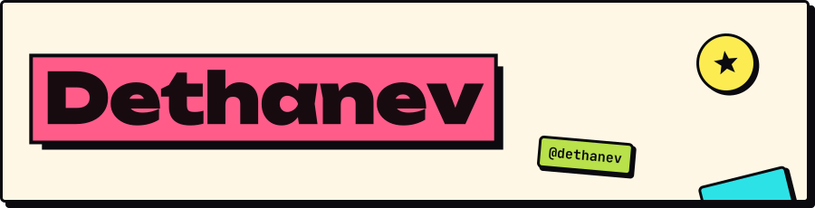</picture>

<br>

<a href="https://www.dethanev.app/"><picture><source media="(prefers-color-scheme: dark)" srcset="assets/readme/btn-blog-dark.svg"></picture></a>&nbsp;&nbsp;<a href="https://algolab.dethanev.app/"><picture><source media="(prefers-color-scheme: dark)" srcset="assets/readme/btn-algolab-dark.svg"></picture></a>&nbsp;&nbsp;<a href="https://quizlab.dethanev.app/"><picture><source media="(prefers-color-scheme: dark)" srcset="assets/readme/btn-quizlab-dark.svg"></picture></a>

</div>

<br>

<picture><source media="(prefers-color-scheme: dark)" srcset="assets/readme/h-projects-dark.svg">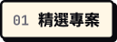</picture>

<p align="center">
<a href="https://algolab.dethanev.app/"><picture><source media="(prefers-color-scheme: dark)" srcset="assets/readme/card-algolab-dark.svg">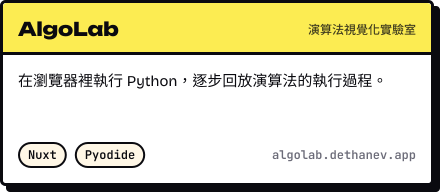</picture></a>
<a href="https://quizlab.dethanev.app/"><picture><source media="(prefers-color-scheme: dark)" srcset="assets/readme/card-quizlab-dark.svg">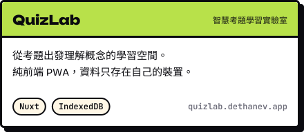</picture></a>
</p>

<p align="center">
<a href="https://github.com/dethanev/DriveWorth-App"><picture><source media="(prefers-color-scheme: dark)" srcset="assets/readme/card-driveworth-dark.svg">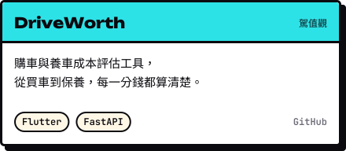</picture></a>
<a href="https://github.com/dethanev/HawkGuard-App"><picture><source media="(prefers-color-scheme: dark)" srcset="assets/readme/card-hawkguard-dark.svg">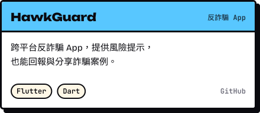</picture></a>
</p>

<p align="center">
<picture><source media="(prefers-color-scheme: dark)" srcset="assets/readme/card-linkpet-dark.svg">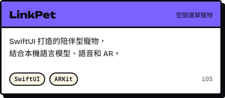</picture>
<a href="https://www.dethanev.app/"><picture><source media="(prefers-color-scheme: dark)" srcset="assets/readme/card-blog-dark.svg">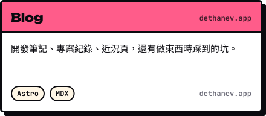</picture></a>
</p>

<br>

<picture><source media="(prefers-color-scheme: dark)" srcset="assets/readme/h-stack-dark.svg">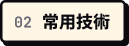</picture>

<p align="center">
<picture><source media="(prefers-color-scheme: dark)" srcset="assets/readme/stack-dark.svg">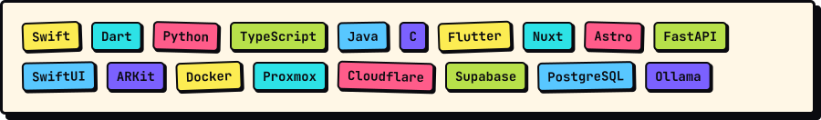</picture>
</p>

<br>

<details open>
<summary><b>開發統計</b></summary>

<br>

<!--START_SECTION:waka-->

```txt
From: 16 August 2025 - To: 06 November 2026

Total Time: 238 hrs 9 mins

Python                     45 hrs 7 mins         ████▓░░░░░░░░░░░░░░░░░░░░   18.45 %
Java                       43 hrs 29 mins        ████▒░░░░░░░░░░░░░░░░░░░░   17.79 %
Markdown                   42 hrs 34 mins        ████▒░░░░░░░░░░░░░░░░░░░░   17.41 %
Dart                       31 hrs 41 mins        ███▒░░░░░░░░░░░░░░░░░░░░░   12.96 %
Astro                      18 hrs 8 mins         ██░░░░░░░░░░░░░░░░░░░░░░░   07.42 %
Swift                      11 hrs 23 mins        █░░░░░░░░░░░░░░░░░░░░░░░░   04.66 %
TypeScript                 7 hrs 23 mins         ▓░░░░░░░░░░░░░░░░░░░░░░░░   03.02 %
Other                      6 hrs 24 mins         ▓░░░░░░░░░░░░░░░░░░░░░░░░   02.62 %
```

<!--END_SECTION:waka-->

<p align="center">
<a href="https://git.io/streak-stats"><picture><source media="(prefers-color-scheme: dark)" srcset="https://streak-stats.demolab.com?user=Dethanev&background=1A1A22&border=EEE6D3&stroke=EEE6D3&ring=E76F9F&fire=E76F9F&currStreakNum=EEE6D3&sideNums=EEE6D3&currStreakLabel=EEE6D3&sideLabels=9A9AAB&dates=9A9AAB&border_radius=4"></picture></a>
</p>

<p align="center">
<picture><source media="(prefers-color-scheme: dark)" srcset="profile-3d-contrib/profile-dethanev-dark.svg">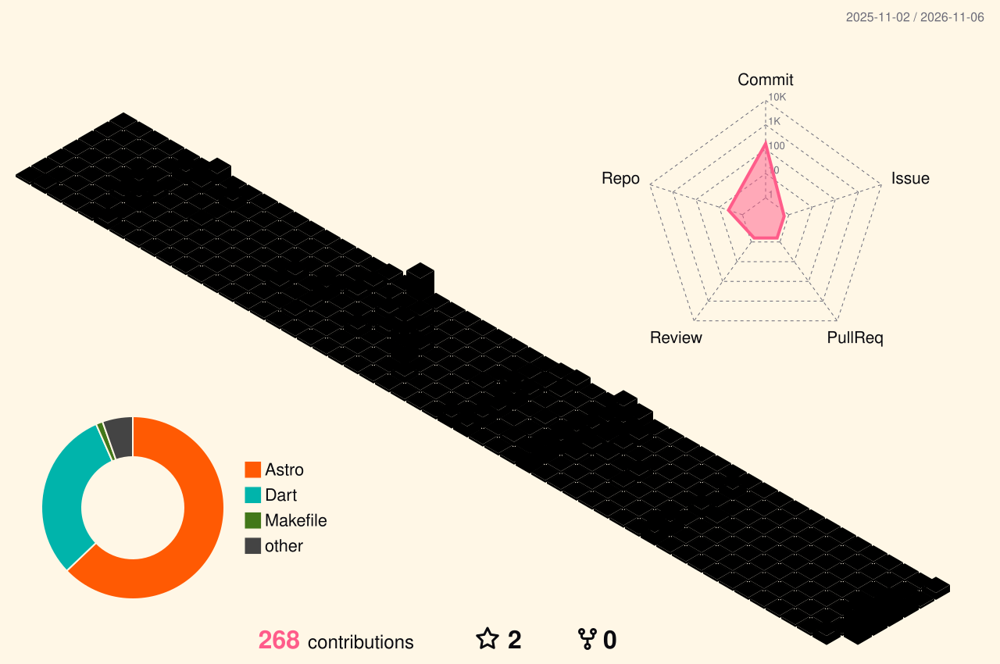</picture>
</p>

</details>

<details>
<summary><b>neofetch</b></summary>

<br>


</details>
